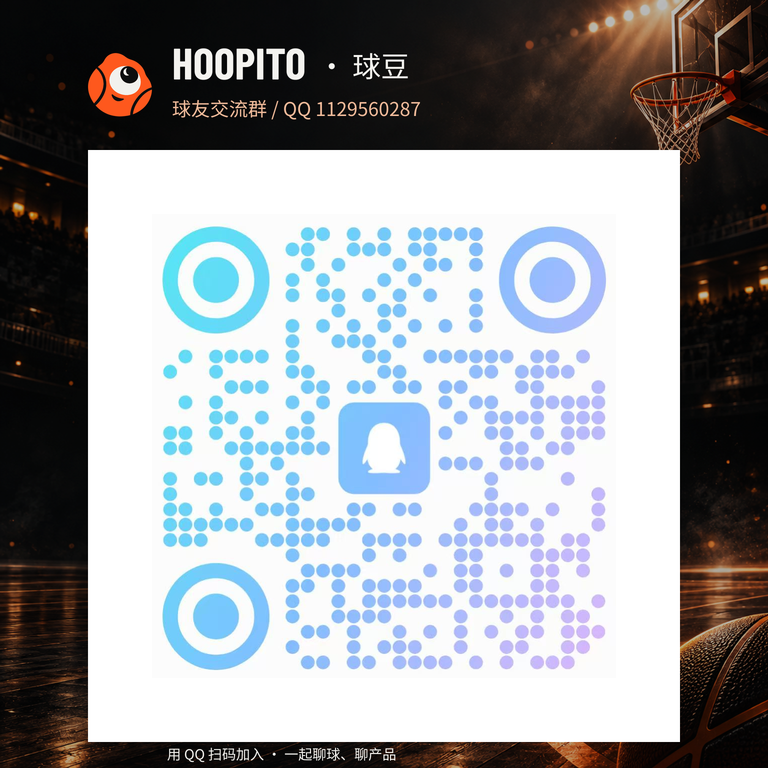

# Hoopito · 球豆

<p align="center">
  
</p>

[](https://github.com/x1a0Y4NGren/hoopito/actions/workflows/flutter-ci.yml)
[](https://github.com/x1a0Y4NGren/hoopito/releases/latest)
[](LICENSE)

> 把注意力留给球场，把比分、落点和复盘交给球豆。

Hoopito（中文名：球豆）是一款为篮球爱好者准备的离线单挑记录与复盘工具。一台手机横过来，就能记比分、犯规、比赛事件和投篮落点；打完球再回头看看比分走势、出手分布和关键回合，弄明白哪一片篮筐今天格外不给面子。

球可以打铁，记录不能糊涂。

> **永久承诺：Hoopito · 球豆官方项目将始终免费并保持开源。** 官方版本不会加入付费墙、订阅、广告或闭源核心功能。

**[中文官网](https://hoopito.com/)** · **[Official website (English)](https://hoopito.com/en/)**

**[下载 v2.1.0 APK](https://github.com/x1a0Y4NGren/hoopito/releases/download/v2.1.0/Hoopito-v2.1.0-android.apk)** · [查看本次更新](docs/release/v2.1.0-release-notes.md) · [安装与备份](docs/release/v2.1.0-release-notes.md#升级与备份) · [隐私说明](PRIVACY.md) · [参与贡献](CONTRIBUTING.md)

**Hoopito · 球豆 v2.1.0** 新增连续对局、自由／目标计分与 Android 应用内更新。沿用 v2 正式证书与安装身份，可覆盖升级 v2.0.0／v2.0.1；请先将完整 JSON 备份保存到 App 外。旧比赛不会自动归组。新版可导入兼容的旧 HoopTrace 与新 Hoopito JSON，**旧 App 无法导入 schema 4 备份，也不能读取升级后的数据库，请勿降级后继续使用该数据库**。历史发行文件和截图保留真实来源，名称与安装身份见[品牌与兼容性](docs/design/brand/naming-and-compatibility.md)。

介绍与下载官网已上线，提供中英文页面、桌面连续 3D 球场和手机二维投篮演示。**本轮没有部署官网，v2.1.0 请使用上方 GitHub 下载入口。** 应用先检查官网版本信息，失败或无效时尝试 GitHub 备源；本次核验官网更新接口返回 404，尚未上线。网站独立于 Flutter 构建，维护说明位于 [`website/`](website/README.md)，既有来源与验收见[网站验收记录](website/VERIFICATION.md)。

> **安装提示：v2 使用新的正式签名，不能覆盖安装历史 v1。** 若旧版有需要保留的记录，请先导出完整 JSON，确认文件已保存在应用之外，再卸载旧版、安装 v2 并恢复。卸载会移除应用私有数据；CSV 和战报图片不能恢复数据库。

**连续对局**让固定两人连打多场，交换红蓝后仍正确累计胜场；平局单列，放弃不计胜负。每场独立计分、计时和复盘，赛后可调整下一场设置，结束整组后可在条件满足时从历史重新打开。自由计分不设目标；目标计分达到 1～999 的设定值后，保留实际比分，由你确认结束或继续。C「独眼球怪」标识与静音 Q 弹启动继续保留，替换恢复与安全副本回退都先保护当前数据。

当前应用版本为 **`2.1.0+6`**，数据库 schema 4、JSON 格式 2。构建、CI、专用模拟器与公开下载核验的实际来源及文件哈希见[发行记录](docs/release/v2.1.0-release-record.md)，历史证据保留原有来源。自动备份默认关闭；自然 24 小时调度未实测，系统后台任务不保证准点执行。

## 先看比赛，不看说明书

<p align="center">
  <a href="https://github.com/x1a0Y4NGren/hoopito/releases/download/v2.1.0/Hoopito-v2.1.0-scoring-zh.png">
    
  </a>
</p>

<p align="center">
  <a href="https://github.com/x1a0Y4NGren/hoopito/releases/download/v2.1.0/Hoopito-v2.1.0-series-zh.png">
    
  </a>
</p>

<p align="center"><sub>画面取自正式签名 v2.1.0 APK，使用虚构双方的三场连续对局。展示副本仅按本次设备的实际系统边界裁除上下各 63px，保留 App 原始像素；横屏为 1920×954，竖屏为 1080×1794。点击图片查看同一干净副本的完整分辨率。中英文、明暗主题的四张图及原图摘要、裁剪矩形见 <a href="https://github.com/x1a0Y4NGren/hoopito/releases/download/v2.1.0/screenshots.json">本次截图来源清单</a>；英文深色画面见 <a href="https://github.com/x1a0Y4NGren/hoopito/releases/download/v2.1.0/Hoopito-v2.1.0-scoring-en.png">计分</a>与<a href="https://github.com/x1a0Y4NGren/hoopito/releases/download/v2.1.0/Hoopito-v2.1.0-series-en.png">整组总结</a>。<a href="docs/release/v2.0.1-screenshots.json">历史 v2.0.1 原图来源</a>与网站既有展示保持原来源。</sub></p>

## 三步打完一场球

1. **开球前**：使用临时名称、已有球员或新建档案；可复用上场配置，确认规则和准备记录的范围。
2. **得分时**：可以先点球场再选分值，也可以先记分、在 10 秒内补上落点；记错一步就撤回一步。
3. **终场后**：确认比分与出手完整度，查看总结、复盘或分享报告；可关联球员档案、再来一场，并查看成长记录。

核心计分与复盘全程不需要账号或网络，也不用在暂停时和复杂表格斗智斗勇。

## 它会记住什么

- 统一横屏计分界面：左右固定为 `+1 / +2 / +3 / 未命中`，球场始终是视觉中心。
- 既支持“先点球场、再选命中或未中”，也支持先记录、在 10 秒内补记位置。
- 顶部集中提供撤回、犯规、更多和结束入口；犯规可快速选择蓝方或红方。
- 得分、落点、未中、犯规、罚球、球权、备注和自定义事件均可按提交顺序逐步撤回。
- 蓝红双方未中点可在当前计分页独立隐藏；白底配球队色叉号，在明暗主题下都能与命中点区分。
- 罚球、球权、备注和自定义事件收进“更多”，现场界面保持清爽。
- 自定义球员名称、规则模板和计时；自由计分或 1～999 目标计分，达标后可确认结束、继续或撤销。
- 固定两人的连续对局，支持交换红蓝、下一场设置、累计胜场、收局和重新打开；每场只计入球员统计一次。
- 本机比赛历史、事件时间线、投篮图、比分走势、单场统计与球员生涯分析。
- 比赛、历史、球员三个主入口；最近结果直达总结，球员列表直达生涯。
- FG% 与 FT% 分开计算；未完整记录出手或分母为零时不显示可信命中率，落点图只表达已记录样本。
- 带审计记录的赛后事件和落点修正，改过什么有迹可循。
- 完整 JSON 备份与恢复、CSV 导出和复盘图片分享。
- 替换或回退前必须保存并校验应用内安全副本；数据页可恢复最近两份。安全副本不能代替设备外的 JSON 备份。
- 用户授权目录内的可选自动备份，默认关闭，选择权始终在你手里。
- 标准、精简和系统关闭动画三种反馈路径；核心计分完全不依赖动画成功与否。

## 当前阵容

- 当前版本：[Hoopito · 球豆 `v2.1.0`](https://github.com/x1a0Y4NGren/hoopito/releases/tag/v2.1.0)，Android `2.1.0+6`，沿用 v2 正式签名，可覆盖升级 v2.0.0／v2.0.1；历史 v1 不能直接覆盖安装。
- 发行应用源码与签名 tag 指向 `9bbd3b87e99d71f5d9117cd2c5a763a7f8b95d1f`，维护分支为 `main`；数据库 schema 4、JSON 格式 2。后续文档、截图与网站提交不改变 APK 构建来源，详见[发行记录](docs/release/v2.1.0-release-record.md)。
- 当前平台：Android 优先，最低 Android API 24，目标 Android API 36。
- Android Application ID：`io.github.x1a0y4ngren.hooptrace`，改名后保留以支持覆盖升级和已有本地数据。
- iOS 无签名编译已纳入 CI，但尚未完成真机验收和正式发布。
- 界面完整支持简体中文和英文；首次打开默认中文，用户可在设置中切换英文。主题可跟随系统或固定为浅色/深色。

## 隐私与离线原则

v2.1.0 提供 Android 应用内更新：在「设置 → 软件更新」手动检查，或使用默认开启、可关闭的启动检查。通过 HTTPS 读取官网信息，失败或无效时尝试 GitHub，不上传比赛、球员、设置或设备标识；分发服务会接收 IP 地址等连接信息。无新版或自动检查失败不打扰计分，未结束的比赛会延后提醒。由你选择下载并在系统安装器中确认，没有静默安装或强制更新；活动比赛期间不能安装。**v2.0.1 不含更新器，需要先手动安装一次新版。** 详见[应用内更新](docs/development/in-app-updates.md)。

连续对局使用 schema 4，JSON 格式仍为 2；支持导入格式/schema 组合 1/2、2/3、2/4，保留旧数据库自动迁移和完整备份恢复。新导出的 schema 4 备份需要 v2.1.0 或更高版本恢复，规则与备份说明见[连续对局维护](docs/development/continuous-matches.md)。

没有账号，没有广告，也不会悄悄把你的比赛送上云端。比赛、球员、规则和设置都保存在设备本地 SQLite 数据库中；应用不包含分析 SDK、追踪 SDK、崩溃遥测或运营后端。

只有在你主动导出、分享或选择备份目录时，数据才会离开应用私有目录。之后的处理由你选择的系统目录或分享目标负责。完整说明见 [PRIVACY.md](PRIVACY.md)。

完整 JSON 的导出与导入均限制为 32 MiB、单表 100,000 行、总计 200,000 行；超限会给出实际值与上限，并保留原数据。CSV 用于阅读和外部分析，不能完整恢复比赛。2.0 球员统计 CSV 改为 13 列，分别提供 FG/FT 计数和命中率；详见[数据兼容契约](docs/release/v2.0.0-upgrade.md#csv-13-列契约)。

## 把它跑起来

推荐使用与当前项目一致的工具链：

- Flutter `3.41.9` stable
- Dart `3.11.5`
- Java 17
- Android SDK，包含可用的模拟器或 Android 设备

```powershell
git clone https://github.com/x1a0Y4NGren/hoopito.git
cd hoopito
flutter pub get
flutter doctor -v
flutter run -d <device-id>
```

计分页会自动要求横屏；主页、历史和设置等页面支持正常设备方向。

## 认真部分

俏皮归俏皮，CI 不放水。以下为完整验证常用命令；日常修改按 [贡献指南](CONTRIBUTING.md#测试要求) 选择相关检查，修一段文案不必重建整个 APK：

```powershell
dart format --output=none --set-exit-if-changed .
flutter analyze
flutter test
flutter test integration_test/main_loop_test.dart -d <android-device-id>
flutter build apk --debug
```

主流程集成测试使用隔离的内存数据库；文件恢复测试使用临时 SQLite 文件，关闭重开不能代替进程重启验收。Flutter 测试运行器结束时会卸载该 Android 用户下的应用，请使用专用测试设备或独立测试用户，并通过 `--device-user <id>` 指定用户。手动安装验收前重新构建普通 MAIN Debug APK，以免安装到测试入口。

## 构建与发布

日常开发可以直接构建 Debug APK：

```powershell
flutter build apk --debug
```

Release APK 必须使用项目维护者保管的正式密钥签名。仓库不会保存密钥；本地签名配置使用被 Git 忽略的 `android/key.properties`。没有密钥时普通 Release 构建会明确失败，只有 F-Droid 或可复现性验证可以显式选择未签名构建。完整流程见 [发布清单](docs/release/release-checklist.md)。

官方发布渠道：

1. [GitHub Releases](https://github.com/x1a0Y4NGren/hoopito/releases) 提供签名 APK、校验和与源码归档。
2. 完成可复现构建核验后申请进入 F-Droid，准备说明见 [F-Droid Notes](docs/release/fdroid-notes.md)。这是 Hoopito · 球豆为保持 GitHub 与 F-Droid 安装包签名一致而设置的项目门槛，并非 F-Droid 收录的一般性要求。

Hoopito · 球豆不计划同时分发两个签名不同的官方 Android 包。F-Droid 首发前必须验证由相同源码重现并匹配 GitHub 上游签名 APK。GitHub Releases 是正式版本的来源。官网及蓝奏云入口按官网当前版本分发相同签名与 SHA-256 的 APK；本轮没有同步官网渠道，v2.1.0 使用上方 GitHub 入口。渠道切换不改变安装身份，避免用户被迫卸载应用并承担本地数据丢失风险。

不要从未知来源安装声称由 Hoopito · 球豆官方发布的 APK。正式版本应能对应到本仓库中的签名 Git tag 和 GitHub Release。

## 逛仓库不迷路

- `lib/app`：应用装配、路由、主题与本地化。
- `lib/core`：领域模型、Drift 数据库、分析、审计与导出。
- `lib/features`：计分、复盘、历史、球员、规则和设置页面。
- `test`：单元测试与 Widget 测试。
- `integration_test`：Android 主流程端到端测试。
- [docs](docs/README.md)：按当前开发、设计、发行和历史分类的文档入口。
- [历史归档](docs/archive/README.md)：早期任务报告、截图和旧工作树脚本，仅供追溯。

## 欢迎上场

Bug、想法、文档改进和代码贡献都欢迎。提交 Issue 或 Pull Request 前请阅读 [CONTRIBUTING.md](CONTRIBUTING.md)。隐私、离线能力和永久免费开源承诺属于不可破坏的项目约束。

### 一起聊球，也聊球豆

球豆球友 QQ 交流群：**1129560287**。欢迎聊篮球、分享使用体验、交流产品想法与开源开发。使用 QQ 扫码，或在 QQ 中搜索群号；同一台手机上可先保存图片，再用 QQ 识别。问题跟踪与代码贡献仍请使用 Issue／Pull Request。

<p align="center">
  <a href="website/public/community/hoopito-qq-group.png">
    
  </a>
</p>

<p align="center"><a href="https://hoopito.com/#community">官网交流入口</a> · <a href="website/public/community/hoopito-qq-group.png">查看完整二维码图片</a></p>

## 设计与动效资产

Hoopito · 球豆沿用 2.0 的“黑场编辑部”界面：近黑比赛顶栏、冷白内容面和克制的竞技橙共同维持信息层级，红蓝只负责表达球队与比赛数据。比分、计时和现场操作优先保证快速辨认，不让装饰抢走比赛注意力。

2.0 统一使用已审核的 C「独眼球怪」平台图标和启动画面；Flutter 启动层采用原图纹理网格，提供约一秒的 Q 弹跳跃、上半部水波与收尾余波，全程静音。原图与资源来源见[品牌记录](docs/design/brand/README.md)，设计参数、预览及设备验收范围见[启动动效记录](docs/design/brand/entry-motion.md)。

现有 Logo 的多尺寸图、组合字标及复现验证见[品牌素材入口](assets/brand/README.md)。[Issue #16](https://github.com/x1a0Y4NGren/hoopito/issues/16) 的整理与验证已通过审阅，不替换已有生产图标。

`assets/animations/paint_ball.json` 与 `assets/animations/paint_splash.json` 是项目原创的、自包含 Lottie JSON 动效，不含外部资源，随应用本地打包并支持离线运行。运行时使用 `lottie 3.3.3`，其 MIT 许可文本记录在 [THIRD_PARTY_NOTICES.md](docs/legal/THIRD_PARTY_NOTICES.md)。

## 许可证

代码和仓库内项目资产按 [MIT License](LICENSE) 发布。
